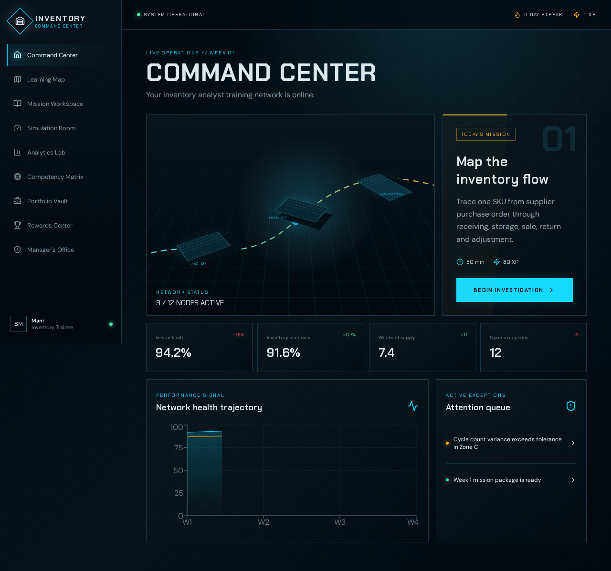
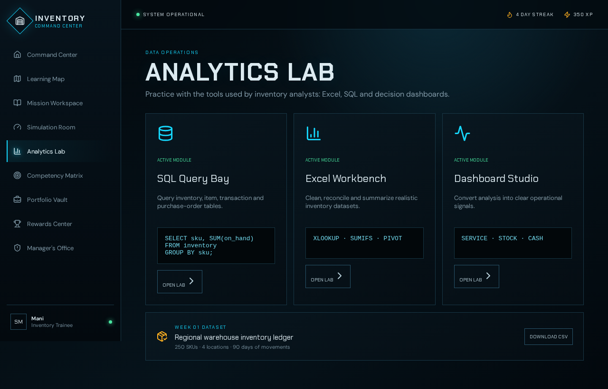
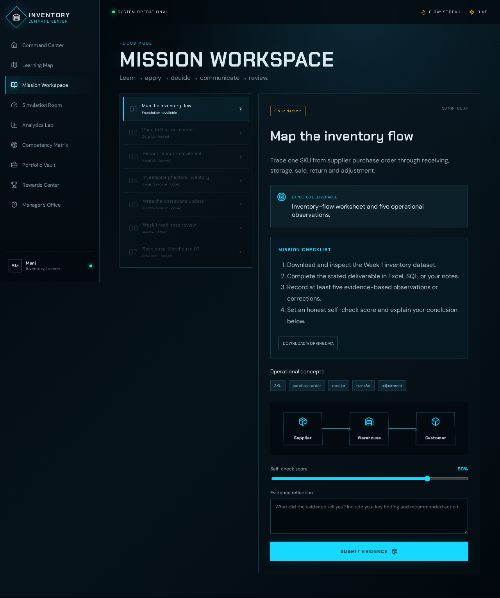
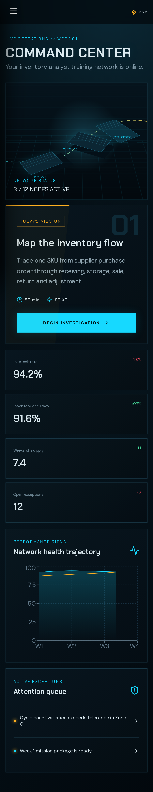
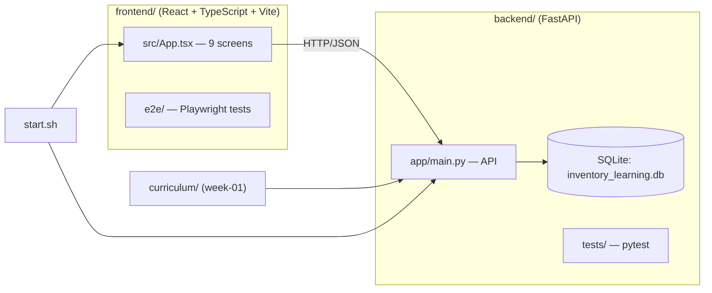

# Inventory Command Center

A local-first, interactive Inventory Analyst learning platform built for Raspberry Pi and desktop browsers.

**Why I built this:** to learn inventory analysis hands-on through missions, simulations, and analytics, in a local-first app that runs on a Raspberry Pi with no cloud account or paid API.

## Screenshots

| Command Center (desktop) | Analytics Lab (desktop) |
|---|---|
|  |  |
| **Mission Workspace (desktop)** | **Command Center (mobile)** |
|  |  |

More desktop and mobile captures are in [`frontend/screenshots/`](frontend/screenshots/).

## Architecture



## Built with AI coding agents

This project was built with AI coding agents working against an engineering contract in [`AGENTS.md`](AGENTS.md), which defines the required stack, the nine screens, product requirements, and testing expectations. I set the requirements, reviewed the output, and verified it with the unit, API, and Playwright E2E test suites below.

## Stack

- React 19, TypeScript, Vite, Framer Motion, Recharts, Lucide
- FastAPI, SQLModel, SQLite, Pydantic
- Vitest, Testing Library, pytest, Playwright
- CSS/SVG isometric 3D logistics scene with reduced-motion fallback

## Screens

Command Center, Learning Map, Mission Workspace, Simulation Room, Analytics Lab, Competency Matrix, Portfolio Vault, Rewards Center, and Manager's Office.

## Raspberry Pi setup

```bash
cd backend && uv sync --dev
cd ../frontend && npm install
npx playwright install chromium
cd ..
chmod +x start.sh
./start.sh
```

Open `http://<raspberry-pi-ip>:5173` or `http://localhost:5173`.

## Verification

```bash
cd backend && uv run pytest -q
cd ../frontend
npm run test
npm run lint
npm run build
npm run test:e2e
```

## Data ownership

- Progress is stored in `backend/inventory_learning.db` (ignored by Git).
- Curriculum data lives under `curriculum/`.
- No paid API, cloud account, or external authentication is required.

## Security

- Input ranges are validated by Pydantic.
- CORS is restricted to local development origins.
- No credentials or secrets are committed.
- This is a single-user local learning application, not an internet-facing multi-tenant service.

## Spline integration

The working visual scene is implemented with CSS/SVG so it loads reliably on a Raspberry Pi. A custom Spline scene can later be lazy-loaded when a `.splinecode` production URL is supplied; the core interface must continue to work without it.
